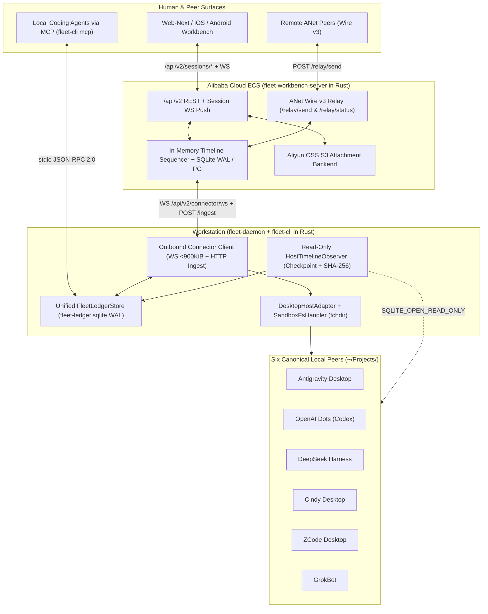

# Unified Rust Workbench Architecture (ANet + Reason + Agents-Anywhere)

## Overview

`agent-fleet` began as a two-source Rust synthesis of `sleep2agi/agent-network` (ANet Wire v3 task correlation and cryptographic receipts) and `reason-machines/reason-network` (session directory discovery, `fchdir` workspace pinning, and five-desktop sidebar mounting). Adding `anywhere-labs/Agents-Anywhere` introduces the missing third dimension, which is a cross-device human workbench (Web, iOS, Android, Desktop) with live timeline streaming, tool/input approval cards, and remote workspace inspection.

If we bolt `Agents-Anywhere`'s Python `anywhere-cli` connector and Python FastAPI server onto `agent-fleet` with wrapper scripts, the two runtimes fight over SQLite WAL locks, duplicate session polling, split state across `~/.agents-anywhere` and `<state_root>/mailboxes.json`, and force every machine to maintain both Python `uv` and Rust toolchains. Instead, this architecture absorbs `Agents-Anywhere`'s wire contracts (`contracts/protocol/1.1`, `contracts/runtime-workflows/1.2`, `contracts/runtime-control/2.1`) directly into the `agent-fleet` Rust workspace. One Rust daemon on the workstation (`fleet-daemon` + `fleet-cli`) and one Rust server binary on Alibaba Cloud ECS (`fleet-workbench-server`) replace the Python stack while serving the unmodified `web-next`, iOS, and Android clients.

## Key concepts and domain model

All domain types live in `crates/fleet-proto` so internal crates share one vocabulary without re-parsing untyped JSON across boundaries.

1. **`CanonicalSessionId` (`sess_{runtime}_{sha256[:24]}`).** A branded identifier derived deterministically from `(connector_id, host_kind, external_session_id)`. Both peer MCP dispatches (`<agent>/<slug>#<session_id>`) and remote workbench sessions resolve to the same `CanonicalSessionId`, eliminating split brain between peer threads and workbench threads.
2. **`TimelineItem` and `TimelineContentHash`.** The atomic unit of conversation state. Every turn, assistant chunk, tool invocation, `<fleet-message>` peer envelope, and file diff is modeled as a `TimelineItem` with a 32-bit signed `TimelineOrderSeq` (`-2_147_483_648..=2_147_483_647`), a server-assigned monotonic `UpdatedSeq` (`i64`), and a deterministic `sha256:...` digest computed over `{type, status, role, content}` with lone surrogates escaped as `\udXXX`.
3. **`DeliveryTier` inside `TimelineItem`.** Upstream `Agents-Anywhere` only knows whether a turn is queued or running. `agent-fleet` embeds `DeliveryTier` (`Accepted`, `ThreadVisible`, `Running`, `Completed`, `Failed`, `Unknown`) and `SidebarProjectBinding` into the timeline metadata so the mobile and web workbench displays cryptographic/store-level proof that the thread is visible in the target desktop app's left sidebar.
4. **`EffectiveCapabilities`.** A typed bitset/struct (`session.send_message`, `session.interrupt`, `session.interaction.approval`, `workspace.read_file`, `workspace.terminal`) computed per host and session state. Clients render buttons strictly from `EffectiveCapabilities`, never by guessing from status strings. For example, `cindy` (0.1.126) advertises `dispatch_channel: anet` and disables local direct injection when no local gateway socket exists.
5. **`SessionNotice` and `InteractionStatus`.** A state machine (`Open -> ResponseAccepted -> Resolving -> Resolved`) governing tool approvals, user questions, and `PlanReviewTicket` approvals (`{review_id, plan_id, plan_revision, content_hash, epoch}`). If `content_hash` or `epoch` changes by a single byte, approval fails closed.

## Six structural conflicts and how the Rust design resolves them

| Conflict area | `agent-fleet` today | `Agents-Anywhere` today | Unified Rust resolution (zero glue) |
| --- | --- | --- | --- |
| **1. Local state persistence** | Rewrites flat `<state_root>/mailboxes.json` and `<host>-state.json` on every message (`FleetMailboxStore`). | Uses `~/.agents-anywhere/<conn>/<rt>/sync-state.json`, `kv.json`, and `coordination.sqlite`. | Replace flat JSON rewrites with `FleetLedgerStore` (`<state_root>/fleet-ledger.sqlite` in `WAL` mode, `0600` permissions) storing sessions, timeline items, peer mailboxes, sync fingerprints, and correlation claims in one ACID store. |
| **2. Native SQLite WAL & writer locks** | Invokes native host RPC/CLI (`codex app-server`, Connect RPC, `zcode`, `dsh`) and reads SQLite back to prove `ThreadVisible`. | Opens `thread_history_1.sqlite` read-only and aborts takeover if another native client holds the writer lock. | Combine both rules in `HostTimelineObserver` and `DesktopHostAdapter`. All history projection opens native databases with `SQLITE_OPEN_READ_ONLY`, compares turn ordinals against `sync_fingerprints`, and checks active writer locks before injecting remote turns. |
| **3. Event granularity** | Returns coarse turn receipts (`HostSessionReceipt`) and diagnostic poll snapshots. | Streams fine-grained `timeline.itemUpsert` deltas coalesced in a `33 ms` client buffer. | `HostTimelineObserver` tails native stores (`state_5.sqlite` + rollout JSONL, `conversation_summaries.db`, `session.v4.jsonl.zstd`, Cindy JSONL, ZCode `db.sqlite`) and emits `TimelineItem` deltas whenever `timeline_content_hash` changes. |
| **4. Transport framing & backpressure** | `DesktopDelivery` uses Unix socket WebSocket; `HubClient` uses HTTP `POST /relay/send`. | Uses outbound `WS /api/v2/connector/ws` (`<= 900 KiB` frames, 8 standard / 2 critical semaphores) with automatic spillover to chunked `POST /api/v2/connector/ingest`. | Implement `ConnectorClient` in `crates/fleet-daemon/src/connector_ws.rs` using `tokio-tungstenite` + `reqwest`, enforcing the `900 KiB` frame threshold, generation fencing, and partial batch rejection isolation (`{accepted, rejected}`). |
| **5. Remote file & terminal sandbox** | Enforces strict `~/Projects/<slug>` containment via `resolve_project_dir_in_root` and kernel-level `libc::fchdir(fd)` in `NodeDaemon`. | Exposes `LocalRpcHandler` for arbitrary workspace file read/write and shell execution. | Route all Connector `workspace.*` and terminal RPCs through `SandboxFsHandler` in `fleet-daemon`, mandatory-gated by `resolve_project_dir_in_root` and `fchdir` descriptor pinning. Remote clients cannot read `.anet`, `.cache`, `PRIVATE`, or paths outside `~/Projects/<slug>`. |
| **6. Cloud server footprint** | `anet.sonori.dev` runs lightweight Go ANetHub `0.3.3`. | Requires Python FastAPI + PostgreSQL 17 + Redis (with AOF `everysec` and `INFO server` ACLs). | Build `crates/fleet-workbench-server` (`axum` + `tokio` + embedded SQLite WAL / optional Postgres). In-process memory lanes + WAL replace Redis Pub/Sub and sequence leases on our single-node Hangzhou Alibaba Cloud ECS (`< 50 MiB` RSS), while serving static `web-next`, `/api/v2/*`, and ANet Wire v3 `/relay/*` from one binary. |

## How it works end-to-end

### Flow 1. Peer-to-peer MCP dispatch mirrored live to the Workbench
When `grokbot` calls `send_message` targeting `zcode/agent-fleet`, `dispatch_unified_message` in `crates/fleet-cli/src/main.rs` validates the slug via `resolve_project_dir_in_root` and checks the prompt via `validate_brief`. It wraps the prompt in `<fleet-message from="grokbot" to="zcode/agent-fleet" id="..." repo="...">` and invokes `ZcodeAdapter::create_session` (or `deliver_turn`). Once ZCode's `tasks-index.sqlite` and `cli/db/db.sqlite` confirm `DeliveryTier::ThreadVisible`, `FleetLedgerStore` commits both the mailbox entry and the initial `TimelineItem` in a single SQLite WAL transaction. If `ConnectorClient` is active, it immediately pushes `timeline.itemUpsert` over `WS /api/v2/connector/ws` to `fleet-workbench-server`, which assigns the next `updatedSeq` and broadcasts `ProtocolEventEnvelope(type="timeline.item_updated")` to your phone and browser.

### Flow 2. Remote human dispatch or approval from phone/Web
When you open the Web Workbench or iOS/Android app and start a task on `openai-dots/my-repo` (or click Approve on a tool notice), the client calls `POST /api/v2/sessions/create-and-start` (or `POST /api/v2/sessions/{id}/runtime/notices/{noticeId}/respond`) on `fleet-workbench-server`. The server claims a sequence revision and sends a JSON-RPC request (`session.create` or `interaction.respond`) down the active `WS /api/v2/connector/ws` channel to `fleet-daemon` on the workstation. `fleet-daemon` verifies that no conflicting local writer lock is active, executes the turn through `OpenAiDotsAdapter` (`codex app-server` Unix socket), verifies sidebar mounting in `state_5.sqlite`, and streams the resulting assistant chunks and tool outputs back through `HostTimelineObserver` -> `ConnectorClient` -> `fleet-workbench-server` -> client WebSocket.

### Flow 3. Disconnect and sequence cursor recovery
Every event pushed to `web-next` or mobile carries `cursor: "seq:<updatedSeq>"`. When a phone wakes from sleep and reconnects, it requests `GET /api/v2/sessions/{sessionId}/events?after=seq:N`. `fleet-workbench-server` reads the delta range `(N, current_seq]` from its WAL table. If the session history was never replaced, it returns `ProtocolEventRecoveryResponse { events, nextCursor, snapshotRequired: false }`. If a compaction or full history replacement occurred while the phone was offline, a reset fence marks `snapshotRequired: true`, prompting the client to fetch `GET /api/v2/sessions/{sessionId}/snapshot` and reconcile via `mergeSequencedTimelineSnapshot`.

## Where things live

| Crate or path | Role in the unified architecture |
| --- | --- |
| `crates/fleet-proto/src/timeline.rs` | `CanonicalSessionId`, `TimelineItem`, `TimelineOrderSeq`, `UpdatedSeq`, and surrogate-safe `timeline_content_hash`. |
| `crates/fleet-proto/src/workbench.rs` | `ProtocolEventEnvelope`, `EffectiveCapabilities`, `SessionNotice`, `InteractionStatus`, `PlanReviewTicket`, and `ConnectorRpcFrame`. |
| `crates/fleet-daemon/src/ledger.rs` | `FleetLedgerStore` (`rusqlite` WAL) unifying peer mailboxes, timeline items, notices, and sync fingerprints. |
| `crates/fleet-daemon/src/observer.rs` | `HostTimelineObserver` read-only incremental history projectors for all 5 desktop hosts + `grokbot`. |
| `crates/fleet-daemon/src/connector_ws.rs` | Outbound v2 Connector WebSocket RPC client + HTTP chunked ingest fallback (`900 KiB` threshold). |
| `crates/fleet-daemon/src/sandbox_fs.rs` | `SandboxFsHandler` enforcing `resolve_project_dir_in_root` and `libc::fchdir` on all remote file/terminal RPCs. |
| `crates/fleet-workbench-server/` | Self-hosted Rust server binary (`axum`) implementing `/api/v2/*`, `/relay/*` (ANet Wire v3), static `web-next` hosting, and Aliyun OSS S3 attachment storage. |
| `docs/workbench-unification-plan.md` | The 6-PR executable slice checklist (`PR-1` through `PR-6`) validated by `check-plan.mjs`. |
| `docs/workbench-handoff-prompt.md` | Ready-to-paste kickoff prompt and mandatory reading scope for the next `agent-fleet` session. |

## Gotchas and non-negotiable invariants

1. **Never write directly to a running desktop host's SQLite WAL.** Always trigger the host's own IPC/CLI (`codex app-server`, Antigravity Connect RPC, `zcode --surface desktop`, `dsh`) so the host updates its own state and UI; open native SQLite databases strictly with `SQLITE_OPEN_READ_ONLY` for verification and timeline projection.
2. **Escape lone surrogates before SHA-256 hashing.** JavaScript strings in `web-next` and DSH can contain lone UTF-16 surrogates (`0xD800..=0xDFFF`). `timeline_content_hash` must escape them as `\udXXX` in deterministic JSON key order `{type, status, role, content}` so Rust hashes match TypeScript and Python byte-for-byte.
3. **Keep `orderSeq` within signed 32-bit integer bounds.** Reject any item outside `-2_147_483_648..=2_147_483_647` with `invalid_order_seq` and isolate individual rejected items inside `/api/v2/connector/ingest` (`HTTP 200` with `{accepted, rejected}`) rather than failing the whole batch.
4. **Do not deduplicate live capability transitions by `eventId`.** Durable `timeline.item_*` events deduplicate by `eventId`, whereas live `runtime.capability.updated` and `runtime.state.updated` events must pass through even at the same sequence number so an `A -> B -> A` capability transition is never dropped.
5. **Preserve dispatcher model ownership.** `validate_brief` runs on every incoming workbench prompt and peer message. Never ask a worker agent to self-attest its model identity or abort with `MODEL_WRONG`.
